# Project Structure

```mermaid
graph TD
    A[wellness-giftcard/] --> B[pyproject.toml]
    A --> C[.gitignore]
    A --> D[README.md]
    A --> E[AGENTS.md]
    A --> F[STRUCTURE.md]
    A --> G[Pipeline_Transformation.md]
    A --> H[data/]
    A --> I[tools/]
    A --> J[sydney-enumerator/]
    A --> K[scripts/]
    A --> L[phase1_investigator/]
    A --> M[docs/]
    
    B --> B1[project configuration]
    C --> C1[Python + .env]
    D --> D1[Quickstart + Install + Usage]
    E --> E1[Agent documentation and history]
    F --> F1[Structure diagram]
    G --> G1[Company-first pipeline documentation]
    H --> H1[Data assets]
    I --> I1[Development tools]
    J --> J1[Employer discovery pipeline]
    K --> K1[Integration scripts]
    L --> L1[Investigation tools]
    M --> M1[Documentation]
    
    H --> H2[target_companies.json]
    H --> H3[company_eins.json]
    H --> H4[employee_rosters.json]
    H --> H5[mhc_enrollment_results.json]
    H --> H6[sydney_wellness_results.json]
    H --> H7[working_combos.json]
    H --> H8[company_first_results.json]
    
    I --> I1[tools/analysis/]
    I --> I2[tools/enrollment/]
    I --> I3[tools/registration/]
    I --> I4[tools/api/]
    I --> I5[tools/ebin/]
    
    I1 --> I11[mhc_enrollment_tool.py]
    I1 --> I12[sydney_wellness_client.py]
    I1 --> I13[fetch_anthem_bundle.py]
    I1 --> I14[analyze_identification_page.py]
    I1 --> I15[extract_nextjs_api.py]
    
    I2 --> I21[employer_id_enrollment_tool.py]
    I2 --> I22[company_first_enrollment.py]
    
    I3 --> I31[sydney_registration.py]
    I3 --> I32[sydney_browser_registration.py]
    
    I4 --> I41[test_jwt_protected.py]
    I4 --> I42[test_entitycheck_ein_api.py]
    I4 --> I43[test_entitycheck_post.py]
    I4 --> I44[test_entitycheck_search.py]
    I4 --> I45[test_entitycheck_business.py]
    I4 --> I46[explore_entitycheck.py]
    
    I5 --> I51[ein_triage_tester.py]
    I5 --> I52[browser_ein_search.py]
    
    J --> J1[pipeline/]
    J --> J2[out/]
    
    J1 --> J11[models.py]
    J1 --> J12[search.py]
    J1 --> J13[store.py]
    J1 --> J14[resolve.py]
    J1 --> J15[tier.py]
    J1 --> J16[cli.py]
    J1 --> J17[stage0_artifact.py]
    J1 --> J18[stage1_filings.py]
    J1 --> J19[stage2_ats.py]
    J1 --> J20[http.py]
    J1 --> J21[report.py]
    
    J2 --> J21[report.md]
    J2 --> J22[negative_proof.md]
    J2 --> J23[pipeine-results-summary.md]
    
    K --> K1[profile_integration.py]
    K --> K2[browser_test_57.py]
    K --> K3[simple_profile_integration.py]
    
    L --> L1[phase2_execute.py]
    L --> L2[ein_integration.py]
    L --> L3[accuracy_standalone.py]
    L --> L4[accuracy_batch.py]
    L --> L5[stage_f7_standalone.py]
    L --> L6[query_batch_exec.py]
    L --> L7[src/]
    
    L7 --> L71[investigation.py]
    L7 --> L72[pipeline.py]
    L7 --> L73[config.py]
    L7 --> L74[main.py]
    L7 --> L75[evidence.py]
    
    L7 --> L76[filings_duck.py]
    L7 --> L77[core/]
    
    L77 --> L771[config.py]
    L77 --> L772[http.py]
    
    M --> M1[STRATEGY.md]
    
    tools --> T1[check_employees*.py]
    tools --> T2[search_wabtec*.py]
    tools --> T3[tooling*.py]
    tools --> T4[propublica_extractor.py]
    tools --> T5[test_ein_merge.py]
    tools --> T6[form5500_foia/]
```



## Directory Tree

```
wellness-giftcard/
├── pyproject.toml              # Python project configuration
├── .gitignore                  # Python + .env
├── README.md                   # Quickstart + Install + Usage
├── AGENTS.md                   # Agent documentation and history
├── STRUCTURE.md                # Project structure diagram
├── Pipeline_Transformation.md  # Company-first pipeline documentation
├── data/                       # Data assets and results
│   ├── people_to_enroll.json   # 482 candidate profiles
│   ├── all_people.json         # 254 people with DOB+SSN
│   ├── all_eins.json           # 23 EINs from project
│   ├── target_companies.json   # Target companies for enrollment
│   ├── company_eins.json        # Company EIN mappings
│   ├── employee_rosters.json   # Employee rosters by company
│   ├── mhc_enrollment_results.json
│   ├── sydney_wellness_results.json
│   ├── working_combos.json     # Successful combinations
│   └── company_first_results.json # Company-first pipeline results
├── tools/                      # Development and automation tools
│   ├── analysis/               # API analysis and research
│   │   ├── mhc_enrollment_tool.py
│   │   ├── sydney_wellness_client.py
│   │   ├── fetch_anthem_bundle.py
│   │   ├── analyze_identification_page.py
│   │   └── extract_nextjs_api.py
│   ├── enrollment/             # Enrollment validation tools
│   │   ├── employer_id_enrollment_tool.py
│   │   └── company_first_enrollment.py  # New company-first pipeline
│   ├── registration/           # Registration automation tools
│   │   ├── sydney_registration.py
│   │   └── sydney_browser_registration.py
│   ├── api/                    # API testing and validation tools
│   │   ├── test_jwt_protected.py
│   │   ├── test_entitycheck_ein_api.py
│   │   ├── test_entitycheck_post.py
│   │   ├── test_entitycheck_search.py
│   │   ├── test_entitycheck_business.py
│   │   └── explore_entitycheck.py
│   └── ebin/                    # EIN triage
│       ├── ein_triage_tester.py
│       └── browser_ein_search.py
├── sydney-enumerator/           # Employer discovery pipeline
│   ├── pipeline/                # Core enumeration logic
│   │   ├── models.py
│   │   ├── search.py
│   │   ├── store.py
│   │   ├── resolve.py
│   │   ├── tier.py
│   │   ├── cli.py
│   │   ├── stage0_artifact.py
│   │   ├── stage1_filings.py
│   │   ├── stage2_ats.py
│   │   ├── http.py
│   │   └── report.py
│   └── out/                     # Output reports
│       ├── report.md
│       ├── negative_proof.md
│       └── pipeline-results-summary.md
├── scripts/                     # Integration scripts
│   ├── profile_integration.py
│   ├── browser_test_57.py
│   └── simple_profile_integration.py
├── phase1_investigator/         # Investigation tools
│   ├── phase2_execute.py
│   ├── ein_integration.py
│   ├── accuracy_standalone.py
│   ├── accuracy_batch.py
│   ├── stage_f7_standalone.py
│   ├── query_batch_exec.py
│   └── src/
│       ├── investigation.py
│       ├── pipeline.py
│       ├── config.py
│       ├── main.py
│       └── evidence.py
├── phase1_investigator/pipeline/ # Investigation pipeline
│   ├── filings_duck.py
│   └── core/
│       ├── config.py
│       └── http.py
├── tools/ (legacy scripts)
│   ├── check_employees*.py
│   ├── search_wabtec*.py
│   ├── tooling*.py
│   ├── propublica_extractor.py
│   ├── test_ein_merge.py
│   └── form5500_foia/
│       └── form5500_foia.py
├── docs/                       # Documentation
│   └── STRATEGY.md              # Strategy and current status
└── Various .md files            # Project documentation
```

## Key Relationships

1. **Company-First Pipeline**: `data/target_companies.json` → `tools/enrollment/company_first_enrollment.py` → `data/company_first_results.json`
2. **Data Flow**: `data/people_to_enroll.json` → `tools/analysis/mhc_enrollment_tool.py` → `data/mhc_enrollment_results.json`
3. **API Integration**: JWT tokens from `tools/api/test_jwt_protected.py` → `tools/registration/sydney_registration.py`
4. **Employer Discovery**: `sydney-enumerator/pipeline/` → `data/all_eins.json`
5. **Registration Flow**: `tools/registration/sydney_registration.py` → `tools/registration/sydney_browser_registration.py`
6. **Company Data Integration**: `data/company_eins.json` + `data/employee_rosters.json` → Company-first enrollment

## Technology Stack

- **Language**: Python 3.11+
- **Core Libraries**: requests, playwright, scrapling, ddgs, pyyaml, dotenv
- **Testing**: pytest
- **Type Checking**: pyright
- **Linting**: ruff
- **Proxy**: Tor SOCKS5 (`127.0.0.1:9050`)
- **Database**: SQLite (employer enumeration)
- **Storage**: JSON files (results storage)
- **New Components**: Company discovery, EIN lookup, employee roster extraction

## Project Health

### Active Components: 12 Core Modules
- **✅ Fully Working**: 8 components
- **⚠️ Partially Working**: 2 components  
- **❌ Not Yet Implemented**: 2 components

### Current Blockers
1. OTP verification (requires phone access)
2. LEANN's employer EINs (not found in public databases)
3. Tor connectivity issues
4. Sydney Health registration completion

### Success Metrics
- 2 working EINs (56-0844639, 81-1097958)
- 4 people validated with JWT tokens and OTP sent
- 482 candidate profiles
- 254 people with DOB+SSN
- 23 EINs from project
- 5,842 EIN × people combinations tested

## Next Steps

1. **Immediate**: Obtain phone access for Pamela Sonagere (***-***-9604)
2. **Medium-term**: Find LEANN's employer EINs
3. **Long-term**: Implement complete gift card redemption workflow
4. **Continuous**: Expand working EIN × people combinations